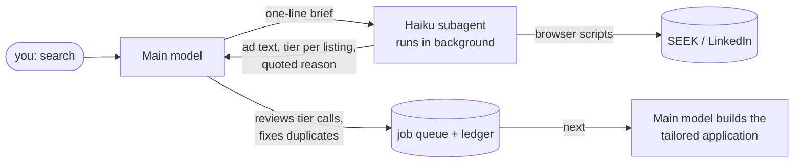

# claude-job-hunt

A small system that turns Claude Code into a job-search assistant. It finds new listings on SEEK and LinkedIn, ranks them against your goals, and builds a tailored application for each one: a one-page resume, a cover letter, and form answers ready to copy. Then it works through them with you one at a time.

Short keywords (`search`, `next`, `status`) keep the routine fast. But it works best as a conversation: as you push back on drafts and say what you like and don't, it writes your preferences into a private rules file, so each session fits you better than the last.

## What you need
- **[Claude Code](https://claude.com/claude-code) desktop app**, with the built-in browser enabled (Settings → Claude Code → Browser). Searches run in that browser, and LinkedIn is read through its public job feed, so no login is needed.
- **Google Chrome**, for rendering the PDFs.
- **`poppler-utils`**, for the `pdfinfo`, `pdftotext` and `pdftoppm` render checks.
- **Python 3.**

## Getting started
1. Clone this repo and open the folder in Claude Code.
2. Say **setup**. Claude will:
   - **ask for your resume** (drop it into the chat, or save it into `me/` if you're using the terminal), pull out everything it can, and then only ask about what's missing (work rights, location, availability, salary and the roles you want);
   - **record your history,** including what you did *not* do, so applications never overclaim;
   - **build your master resume** from `templates/resume.html` and check it renders to one clean page;
   - **research search terms:** it tests SEEK and LinkedIn keywords against real listings near you, works out good-fit, stretch and backup roles from your skills, and confirms them with you;
   - **offer to review your LinkedIn and SEEK profiles** and write paste-ready improvements (headline, About, skills, Open to Work settings);
   - **create your private folders** (`me/`, `applications/`, `data/`) and a private `CLAUDE.local.md` for your own rules. These are gitignored, so your details never end up in the repo. Changes you ask for go into `CLAUDE.local.md`, so the shared files stay as shipped and `git pull` brings in updates cleanly.
3. Say **search** for your first sweep, then **next** to start working through the results.

## Make it yours as you go
`setup` gets you started, but the useful rules come from working through real listings. Say what you think as you go, and Claude turns it into a rule in your `CLAUDE.local.md`. It adds a rule when you ask for one. When you're frustrated with something or have a new idea, it suggests a specific rule and adds it only if you agree, so the file stays short. Some rules that came out of real use:
- "Warn me before building anything that applies through SuccessFactors. Those forms take forever."
- "Treat 'ok next' as `next`."
- "Open application notes in the Files pane, not an external editor."
- Loose ends, like an answer you're still checking or a listing on hold, are kept under Open items so the next session picks them up.

Corrections count too. "I helped build that, I didn't lead it" goes into your profile, so no later application overclaims it.

It also looks past your target roles. A role outside them that your record backs up (good marks in the relevant units, a matching project or cert) is kept with a ★ instead of being discarded. When one is in a kind of role you haven't mentioned, it shows you the listing and asks whether you'd considered it. Say you're interested, and roles like it stop being filtered out. It also offers to search for them, but searches only widen if you ask. If you already know your track, tell it during `setup` and it sticks to your targets.

## Keywords
Each keyword only triggers when it's your whole message.

| Keyword | What it does |
|---|---|
| `search` | Pulls any project updates first, then finds listings posted since your last search, screens them with a cheaper background model, and adds the good ones to your queue. It asks first if you searched in the last 24 hours. |
| `next` | Moves on from the current listing (assumed applied, or passed) to the next one. Good fits are checked and built automatically. Stretches and backups get a summary first. |
| `build` | Builds the stretch or backup listing you're looking at. |
| `status` | Where you are in the queue, and what's left in each tier. |
| `where` | Restates where you are, what's pending on the current listing, and what `next` will do. |
| `refresh` | Re-checks the current tier for closed or changed ads. |
| `profile` | Reviews and updates your profile and search terms. |
| `setup` | Runs onboarding (again). |
| `help` | Lists the keywords. |

You can also paste any job link. Claude checks whether it's already handled, judges the fit, and builds the application, or tells you why it isn't worth it.

## Design notes
This project is mostly an exercise in using an AI agent well: giving it the right context, keeping its costs down, and making sure its output can be trusted.

### Model delegation

- **The bulky, mechanical part goes to a cheaper model.** Running the searches, reading every ad and sorting listings into tiers is handed to a Haiku subagent in the background. It quotes the requirement behind every call ("3+ years", "requires NV1").
- **Judgment stays with the main model.** It reviews the subagent's calls before anything reaches the queue. In testing, Haiku was reliable on clear rule-outs but over-generous with stretch roles, so that review step is built in rather than optional.
- **Context isolation matters more than the per-token price.** The ad text stays in the subagent's context. The main conversation only gets a ~1.5k-token summary, so later turns don't keep re-reading tens of thousands of tokens of job ads.
- **Tailoring stays with the main model too.** Resumes and cover letters depend on knowing what's true about you, which a cold-started subagent doesn't have.

### Keeping runs cheap
- **A ledger of every listing ever seen** (`ledger.py`) means nothing is screened twice. Searches only cover the days since the last run.
- **The seen list lives in browser storage** on each site, so hundreds of IDs never pass through the model. The script checks its count against the ledger and asks for a reseed if they drift apart.
- **A title and salary filter runs in the browser** before any ad is opened. In one test it removed 24 of 29 new listings for free.
- **One-line answers from `ledger.py`** (`days`, `count`, `prefix`, `since`), so nothing has to read whole files.
- **A 24-hour guard** asks before running a search that would find almost nothing.
- **Measured:** the first full sweep screened ~300 listings into a 23-item shortlist. A delegated top-up run went from 91k to 76k subagent tokens and from 4 to 2 minutes once the browser-stored seen list was added. The 76k still included a one-off reseed.

### Trust
- **`me/personal-profile.md` holds what's true *and* what not to claim** (shared work, unconfirmed details), and every application is checked against it.
- **Every PDF is render-checked:** one page, no orphan words, and a clean preview image.
- **Applications are never edited after they're built,** so each folder stays a record of what was sent.

### Resumable by design
- **The queue keeps `Mode:` and `Current:` lines,** and every keyword reads state from files. Any new session can pick up exactly where the last one stopped (`where`, `status`).
- **Application notes put every form answer in its own code block,** so it's one copy click per field.

## How it fits together
```
CLAUDE.md          the rules Claude follows (generic, so no personal data)
tools/
  ledger.py        ledger of every listing seen, so nothing is screened twice
  seek-search.js   search scripts that run in the built-in browser;
  linkedin-search.js  their seen list lives in browser storage, which keeps runs cheap
  job-details.js   pulls the requirement lines out of each ad
  search-brief.md  instructions for the background screening agent
  make_letter.py   cover letter builder (reads your name and contact details from me/config.json)
  update.py        pulls project updates before each search (fast-forward only, never touches your files)
templates/         blank profile, config, resume, queue and skipped list
me/                your profile, config and master resume          (gitignored)
applications/      one folder per role: resume, letter, application.md  (gitignored)
data/              ledger, queue, skipped list, last search time    (gitignored)
```

## Ground rules it follows
- **Every resume and letter is render-checked:** one page, no orphan words, and a clean preview.
- **Submitted applications are never edited afterwards.** Improvements go into the master resume instead.
- **Claims are checked against your profile,** and anything unconfirmed is flagged rather than included.
- **It never sends messages for you, and never asks for ID documents in chat.**

## Contributing
Found a bug or have an idea that would help everyone? Open an issue or a pull request. Keep personal details out of shared files: they belong in `me/` and `CLAUDE.local.md`.
